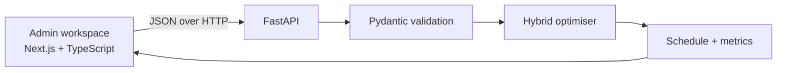
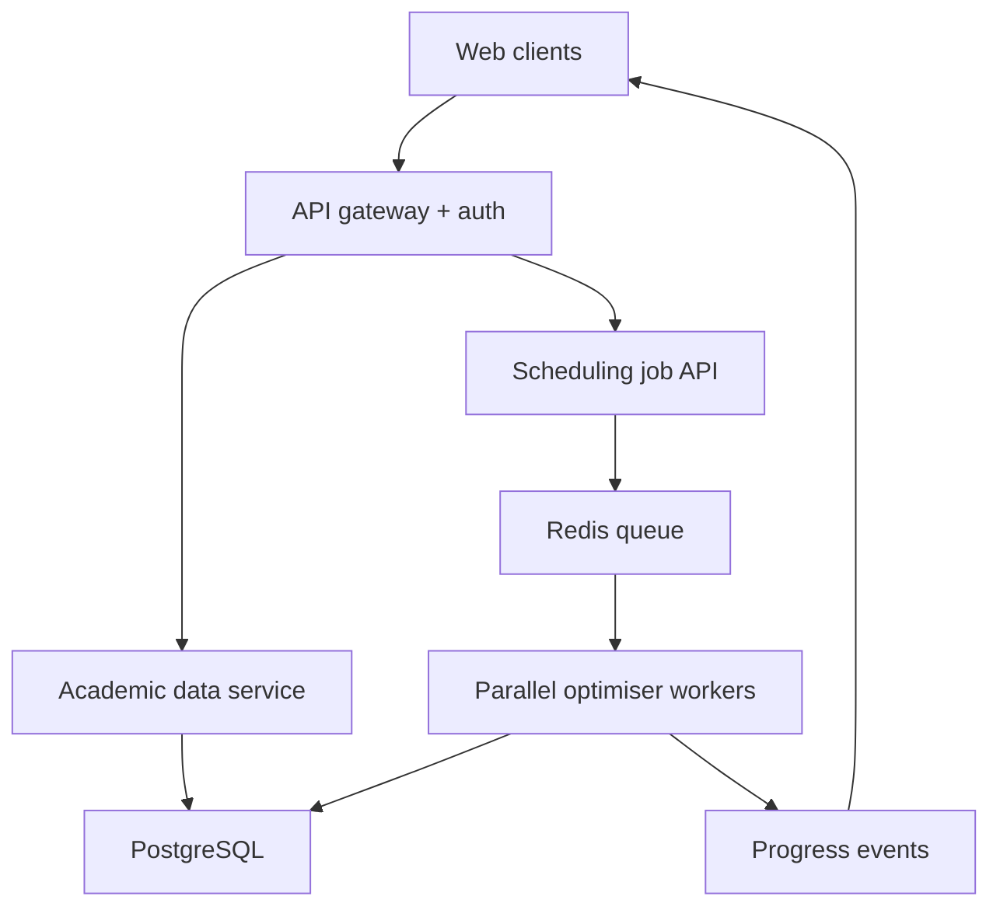

# Architecture

## Current prototype



The frontend and backend are deliberately separate. The interface can be
deployed independently, while the CPU-bound optimiser can scale in its own
container.

## Backend modules

- `models.py`: the typed contract for days, slots, rooms, faculty, courses and
  optimisation settings.
- `sample_data.py`: a deterministic institution dataset used by the live demo.
- `optimizer.py`: representation, constraint evaluation, GA, repair, Tabu
  Search and response metrics.
- `main.py`: health, sample, validation and generation endpoints.

## Core data boundary

`Course.weekly_sessions` describes what must exist. The optimiser expands each
course into session genes such as `CS201-1`, `CS201-2` and `CS201-3`.

A placement is:

```text
(day_index, start_slot_index, room_index)
```

The course supplies the faculty, student group, duration, room type and
capacity requirements. Keeping requirements separate from placements makes
re-optimisation and auditing possible.

## Production evolution



The prototype runs optimisation synchronously because its sample completes
quickly. A production institution should move each run to a worker queue, save
immutable timetable versions, stream progress and support role-based access.

## Recommended production entities

- Institution, Department, Programme, Term
- Course, SessionRequirement, Faculty, FacultyAvailability
- Room, RoomFeature, StudentGroup, TimeSlot
- ConstraintProfile, ScheduleRun, TimetableVersion
- ScheduledSession, ManualOverride, LockedSession

The most important split is `SessionRequirement` versus `ScheduledSession`.
